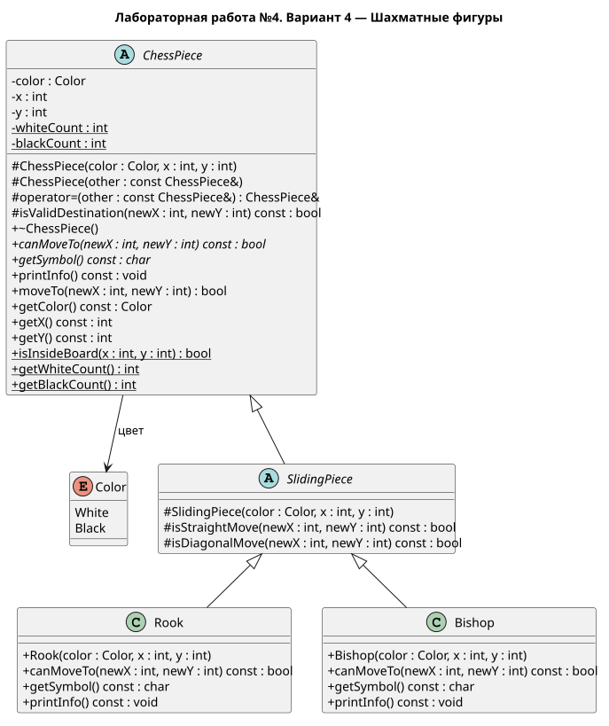

# Лабораторная работа №4

## Описание

Вариант 4 — Шахматные фигуры

Лабораторная работа посвящена наследованию и полиморфизму в C++

Стандарт языка: C++14

Документация создаётся с помощью Doxygen, диаграмма классов — PlantUML

## Часть 2

Реализован абстрактный класс `ChessPiece`, который хранит цвет и позицию фигуры

Добавлены чисто виртуальные методы `canMoveTo()` и `getSymbol()`, виртуальный вывод информации, виртуальный деструктор и метод выполнения хода

При неправильных координатах или цвете конструктор выбрасывает исключение. Неправильный ход не меняет позицию

Цвет и позиция копируются независимо. Отдельные статические счетчики учитывают существующие белые и черные фигуры

Добавлен промежуточный абстрактный класс `SlidingPiece` с общими правилами движения по прямой и диагонали. От него наследуются ладья `Rook` и слон `Bishop`

В программе показаны правильные и неправильные ходы через указатели `ChessPiece*`. Ладья и слон переопределяют вывод информации. Препятствия будут учитываться после добавления доски

Проверки находятся отдельно в `tests/main.cpp`. Успешные условия не выводятся по одному, в конце появляется короткий итог

## Документация

- [Проектирование](pages/design.md)
- [Требования работы](pages/requirements.md)
- [Результат работы](pages/result.md)
- [Ладья и слон](pages/sliding.md)
- [Исходник UML](uml/chess.puml)



## Сборка и запуск

Нужен компилятор `g++` в PATH

```powershell
.\build.bat
.\build\lab4.exe
```

Отдельная программа с проверками:

```powershell
.\build\lab4-tests.exe
```

## Создание документации

Нужен установленный Doxygen

```powershell
.\docs.bat
```

Открыть `docs/html/index.html`

Для перерисовки UML можно использовать редактор с PlantUML или Java:

```powershell
java -jar plantuml.jar -tsvg uml/chess.puml
```
